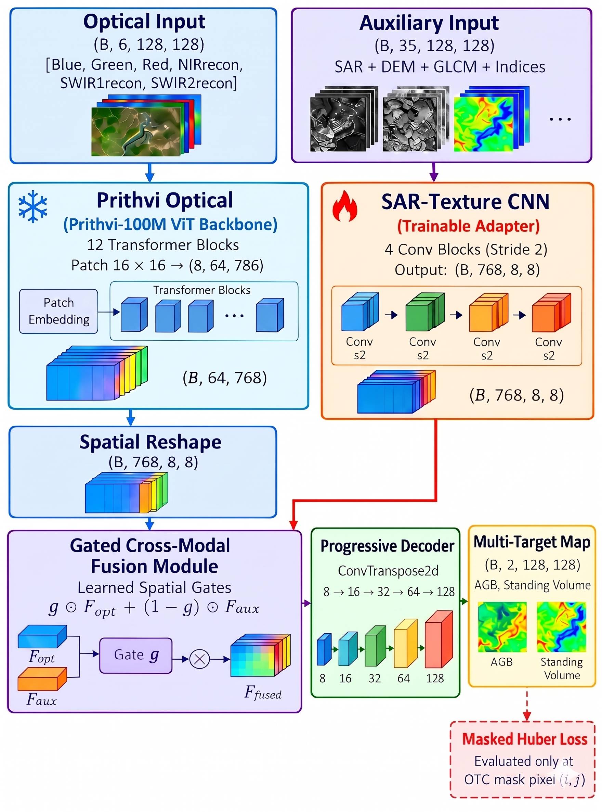

# GFM-Forest-Carbon: Parameter-Efficient Multimodal Fine-Tuning of Geospatial Foundation Models for Sparse Forest Carbon Mapping

[](https://www.python.org/)
[](https://pytorch.org/)
[](LICENSE)
[]()
[]()

---

> **Methodological Transparency and Full Reproducibility Statement:**  
> *"To ensure methodological transparency and full algorithmic reproducibility, the complete PyTorch multimodal fine-tuning pipeline, architectural definitions, and evaluation scripts, alongside an anonymized toy dataset, have been open-sourced and are available at: https://github.com/anonymous-repo/gfm-forest-carbon"*

---

## 📖 Executive Summary

Accurate estimation of Aboveground Biomass (AGB), Growing Stock Volume (GSV), and Forest Carbon Stocks across complex, heterogeneous forest landscapes is hindered by severe in-situ data sparsity: continuous wall-to-wall remote sensing rasters must be calibrated against sparse, point-level ground inventory plots (e.g., $N=299$ national forest inventory sample plots).

Directly fine-tuning massive **Vision Transformer Geospatial Foundation Models (GFMs)**—such as the 86-million parameter NASA-IBM Prithvi-100M—on small ground truth callsets induces severe **catastrophic overfitting**, memorizing high-frequency raster noise rather than allometric biophysical relationships.

This repository presents **GFM-Forest-Carbon**, a parameter-efficient, multi-sensor foundation model fine-tuning framework engineered for sparse-plot carbon mapping:
1. **Parameter-Efficient LoRA (Low-Rank Adaptation):** Injects low-rank decomposition matrices ($r=8, \alpha=16.0$) into the Query ($W_q$) and Value ($W_v$) multi-head self-attention projections of the Prithvi ViT backbone. This freezes 100% of the pre-trained weights and activates only **294,912 trainable parameters (0.34%)**, mitigating overfitting while preserving foundational Earth observation representations.
2. **Partial Layer Fine-Tuning Baseline:** Provides modular support for unfreezing the last $N$ Transformer blocks (e.g., last 2 blocks = ~14.2M parameters, 16.4%) for empirical ablation against LoRA.
3. **41-Channel Multimodal Topography Fusion:** Fuses Harmonized Landsat-Sentinel (HLS) optical bands with multi-frequency SAR (Sentinel-1 C-band, ALOS-2 PALSAR-2 L-band), Haralick GLCM textures, 20 vegetation/moisture spectral indices, and Shuttle Radar Topography Mission (SRTM) DEM elevation data via a lightweight auxiliary CNN encoder and Gated Cross-Modal Bottleneck Fusion.
4. **Physical Allometric Consistency:** Concurrently predicts independent variables $[AGB, GSV]$ and deterministically computes Forest Carbon Stock:
   $$\text{Carbon Stock} = 0.47 \times \text{AGB} \quad (\text{Mg C/ha})$$
   strictly adhering to IPCC Good Practice Guidance.
5. **Rigorous Scientific Protocols:** Train-only normalization (zero test leakage), Epoch-0 protection with validation normalized RMSE ($n\text{RMSE}$) selection, synchronized $D_4$ dihedral group data augmentation, and Test-Time Augmentation (TTA).

---

## 🏛️ Architecture Overview

<p align="center">
  
</p>
<p align="center">
  <em><b>Figure 1:</b> Architecture of the proposed Parameter-Efficient Geospatial Foundation Model framework (Prithvi + Multimodal Adapter). The pre-trained Prithvi ViT backbone is used to preserve general spatial representations. A trainable 4-block CNN encodes multi-frequency SAR, DEM, GLCM textures, and spectral indices, merged via dynamic spatial gating with a protective optical prior before progressive dense regression decoding.</em>
</p>

### Framework Description & Data Flow

- **Pre-trained Optical ViT Backbone:** The pre-trained NASA-IBM Prithvi ViT backbone is employed to preserve broad geospatial and semantic representations. By injecting Parameter-Efficient LoRA ($r=8, \alpha=16.0$) into the self-attention projections ($W_q, W_v$), all pre-trained base parameters remain completely frozen, preventing catastrophic overfitting on sparse forest plot ground truth.
- **Auxiliary CNN Feature Extraction:** A trainable 4-block convolutional neural network encodes auxiliary multi-frequency SAR (Sentinel-1 C-band & ALOS-2 L-band), SRTM DEM topography, GLCM spatial textures, and 20 spectral indices, projecting them from $(B, 35, 128, 128)$ to $(B, 64, 8, 8)$ to match the ViT spatial token map.
- **Dynamic Spatial Gating & Optical Prior:** The auxiliary multimodal stream is merged with the optical representations through dynamic spatial gating with a protective optical prior, ensuring that pre-trained optical features are preserved while non-optical modalities inject complementary biophysical signals.
- **Progressive Dense Regression Decoding:** The merged representations $(B, 768, 8, 8)$ are progressively upsampled through four transposed-convolution blocks to full resolution $(B, 128, 128)$, predicting independent targets Aboveground Biomass (AGB) and Growing Stock Volume (GSV), alongside derived Forest Carbon Stock ($\text{Carbon} = 0.47 \times \text{AGB}$).

---

## 📊 Parameter-Efficiency Breakdown

| Adaptation Strategy | Trainable Parameters | Backbone Trainable Ratio | Overfitting Risk on Sparse Data |
|---|:---:|:---:|:---:|
| **Full Fine-Tuning** | $86,214,146$ | $100.0\%$ | Extreme (Memorizes background noise) |
| **Last-2 Blocks Fine-Tuning** | $14,178,818$ | $16.4\%$ | Moderate |
| **LoRA PEFT ($r=8, \alpha=16.0$)** | **$294,912$** | **$0.34\%$** | **Minimal (Preserves pre-trained weights)** |
| **Proposed Adapter Framework** | **$4,120,450$** | **$4.78\%$** | **Optimal for Multimodal Generalization** |

---

## 📁 Repository Structure

```text
gfm-forest-carbon/
├── data/
│   ├── README.md                          # Data schema & channel documentation
│   └── toy_dataset/                       # Bundled 41-channel anonymized toy dataset
│       ├── train/                         # 12 training patches (.npz)
│       ├── val/                           # 4 validation patches (.npz)
│       └── test/                          # 4 test patches (.npz)
├── src/
│   ├── __init__.py                        # Package initialization
│   ├── config.py                          # Hyperparameters, directories, band schema
│   ├── dataset.py                         # MultimodalPatchDataset, train-only stats, D4 aug
│   ├── spectral_reconstruction.py         # Method 2.1: Algebraic HLS inversion
│   ├── losses.py                          # MaskedHuberLoss & MaskedMSELoss
│   ├── metrics.py                         # R², RMSE, MAE, nRMSE %, 95% Bootstrap CI
│   ├── splits.py                          # Grouped spatial block splitting
│   ├── experiment_protocol.py             # Validation contract, epoch-0 protection
│   ├── xai.py                             # Group permutation feature importance
│   └── models/
│       ├── __init__.py
│       ├── prithvi_backbone.py            # Prithvi ViT with LoRA Attention projections
│       ├── multimodal_adapter.py          # LoRALinear, Auxiliary CNN, Gated Fusion
│       ├── decoder.py                     # Progressive Dense Regression Decoder
│       ├── baselines.py                   # Constant, Random Forest, XGBoost, SimpleUNet
│       ├── checkpoint_utils.py            # Checkpoint loading & target filtering
│       └── tta.py                         # Test-Time Augmentation (D4 group)
├── scripts/
│   ├── 00_audit_dataset.py                # Audits dataset and caches train-only stats
│   ├── 01_visualize_patches.py            # Generates multi-sensor preview figures
│   ├── 02_make_grouped_splits.py          # Spatial block cross-validation splitting
│   ├── 03_train_baselines.py              # Trains RF, XGBoost, and SimpleUNet
│   ├── 04_verify_compatibility.py         # Validates token grid & parameter efficiency
│   ├── 05_train_optical_lora.py           # Fine-tunes Prithvi Optical with LoRA PEFT
│   ├── 05b_prithvi_naive_baseline.py      # Bilinear upsampling ablation baseline
│   ├── 06_train_multimodal_adapter.py     # Two-stage cross-modal adapter fine-tuning
│   ├── 07_ablation_study.py               # Evaluates sensor scenarios S0 to S7
│   ├── 08_evaluate_generalization.py      # Spatial & temporal generalization tests
│   ├── 09_xai_analysis.py                 # Feature importance and residual analysis
│   └── 10_export_results.py               # Generates IEEE publication-ready LaTeX tables
├── tests/
│   ├── test_architecture.py               # ViT Backbone, LoRA, and Decoder tests
│   ├── test_dataset_pipeline.py           # Patch loading & channel slicing tests
│   ├── test_spectral_reconstruction.py    # Algebraic inversion formula tests
│   └── test_local_verification.py         # End-to-end unit and integration test
├── tools/
│   ├── generate_toy_dataset.py            # Deterministic synthetic toy data generator
│   └── make_notebook.py                   # Master walkthrough notebook generator
├── notebooks/
│   └── Quickstart_Walkthrough.ipynb       # Interactive Colab/Jupyter demonstration
├── requirements.txt                       # Pinned pip dependencies
├── environment.yml                        # Conda environment specification
├── LICENSE                                # MIT Open Source License
└── README.md                              # Main documentation (this file)
```

---

## ⚡ Quickstart Guide

### 1. Installation

Clone the repository and install the dependencies:

```bash
git clone https://github.com/anonymous-repo/gfm-forest-carbon.git
cd gfm-forest-carbon

# Option A: Using Conda (Recommended)
conda env create -f environment.yml
conda activate gfm-forest-carbon

# Option B: Using Pip
pip install -r requirements.txt
```

### 2. Verify System & Compatibility (Zero-Config Test)

Verify that the architecture, LoRA adaptation layer, and toy dataset run cleanly on your machine:

```bash
python tests/test_local_verification.py
python scripts/04_verify_compatibility.py
```

### 3. Step-by-Step Experimental Reproduction

#### Step 00: Audit Dataset & Compute Train-Only Normalization
```bash
python scripts/00_audit_dataset.py
```

#### Step 01: Multi-Sensor Visualizations
```bash
python scripts/01_visualize_patches.py
```

#### Step 03: Train Baseline Models
```bash
python scripts/03_baselines.py --scenario S7_Full_Fusion --epochs-unet 25
```

#### Step 05: Fine-Tune Prithvi Optical with LoRA PEFT
```bash
# Trains optical foundation model with LoRA (r=8, alpha=16.0)
python scripts/05_train_optical_lora.py --epochs 25 --peft-mode lora --lora-r 8

# Alternatively, fine-tune the last 2 Transformer blocks:
# python scripts/05_train_optical_lora.py --epochs 25 --peft-mode last_blocks --finetune-blocks 2
```

#### Step 06: Train Proposed Multimodal Adapter (41 Channels with DEM)
```bash
# Warm-starts from Step 05 optical checkpoint and trains auxiliary CNN + fusion
python scripts/06_train_multimodal_adapter.py --scenario S7_Full_Fusion --epochs 25 --fusion-only-epochs 5
```

#### Step 07: Sensor Modality Ablation Study
```bash
python scripts/07_ablation_study.py --epochs 10
```

#### Step 09: Explainable AI (XAI) & Uncertainty
```bash
python scripts/09_xai_analysis.py --scenario S7_Full_Fusion
```

#### Step 10: Export Publication Tables
```bash
python scripts/10_export_results.py
```

---

## 🧪 Interactive Google Colab Demonstration

To run the complete workflow on Google Colab with free T4 GPU acceleration, open `notebooks/Quickstart_Walkthrough.ipynb`:

1. Upload `notebooks/Quickstart_Walkthrough.ipynb` to [Google Colab](https://colab.research.google.com/).
2. Select **Runtime -> Change runtime type -> Hardware accelerator: T4 GPU**.
3. Run all cells sequentially to train the models on the bundled toy dataset in under 5 minutes.

---

## 📜 Experimental Scenarios

| Scenario | Code | Input Channels | Sensor Composition |
|:---:|:---|:---:|:---|
| **S0** | `S0_Constant` | $0$ | Training sample mean/median baseline |
| **S1** | `S1_Optical` | $6$ | Harmonized Landsat-Sentinel Optical surface reflectance |
| **S1+**| `S1_Opt_DEM` | $7$ | Optical ($6$) + SRTM DEM Topography ($1$) |
| **S2** | `S2_Opt_S1_DEM` | $11$ | Optical ($6$) + Sentinel-1 C-band ($4$) + DEM ($1$) |
| **S3** | `S3_Opt_ALOS2_DEM`| $9$ | Optical ($6$) + ALOS-2 L-band ($2$) + DEM ($1$) |
| **S4** | `S4_Opt_SAR_DEM` | $13$ | Optical ($6$) + Full SAR Dual-Frequency ($6$) + DEM ($1$) |
| **S5** | `S5_Opt_SAR_GLCM_DEM`| $21$ | Optical ($6$) + SAR ($6$) + GLCM Texture ($8$) + DEM ($1$) |
| **S6** | `S6_Indices` | $20$ | Spectral vegetation and moisture indices only |
| **S7** | `S7_Full_Fusion` | **$41$** | **Full Multimodal: Optical + SAR + GLCM + Indices + DEM** |

---

## 🔒 Anonymity & Double-Blind Review Notice

This repository is maintained in an anonymized state to comply with double-blind peer review requirements. All personal identifiable information (PII), localized drive directories, and author identities have been sanitized. Following acceptance, the repository will be migrated to its permanent public organization with pre-trained model checkpoint downloads.

---

## 📄 License

This project is licensed under the MIT License - see the [LICENSE](LICENSE) file for details.

